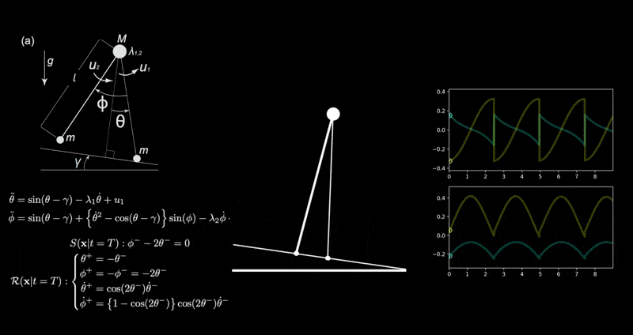

# Koopman Operator Based Time-Delay Embeddings and State History Augmented LQR for Periodic Hybrid Systems: Bouncing Pendulum and Bipedal Walking
MECC2025  [arXiv](https://arxiv.org/pdf/2507.14455)

## Demonstrations

### Bouncing Pendulum

<!-- Insert GIF here -->

  

### Bipedal Walking

<!-- Insert GIF here -->

  

