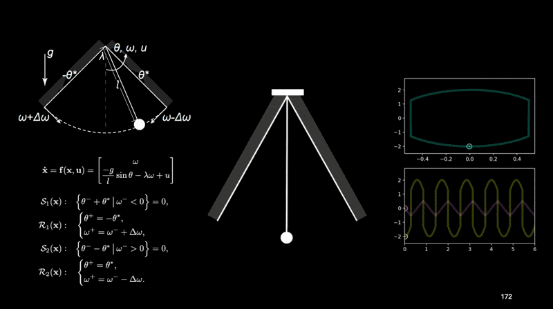

# Koopman Operator Based Time-Delay Embeddings and State History Augmented LQR for Periodic Hybrid Systems: Bouncing Pendulum and Bipedal Walking

MECC2025 [arXiv](https://arxiv.org/pdf/2507.14455)

<table align="center">
  <tr>
    <th align="center">Bouncing Pendulum</th>
    <th align="center">Bipedal Walking</th>
  </tr>
  <tr>
    <td align="center" width="50%">
      
    </td>
    <td align="center" width="50%">
      
    </td>
  </tr>
</table>
